<div align="center">


# LionAxon

### Your design idea, told in blocks.

**Parti diagrams and massing studies for architecture — from the first volume to the printed sheet.**<br>
Simple to learn in an afternoon. The same app on Windows, macOS and Linux. Free.

<sub>by the <b>LionAxon Team</b> · created and conceived by <b>Daniel Michelon De Carli</b> · part of the Lion family, with <a href="https://github.com/danielcarli/lionorganizer">LionOrganizer</a> and <a href="https://github.com/danielcarli/lionphotos">LionPhotos</a></sub>

**English** · [Português (Brasil)](docs/README.pt-BR.md)


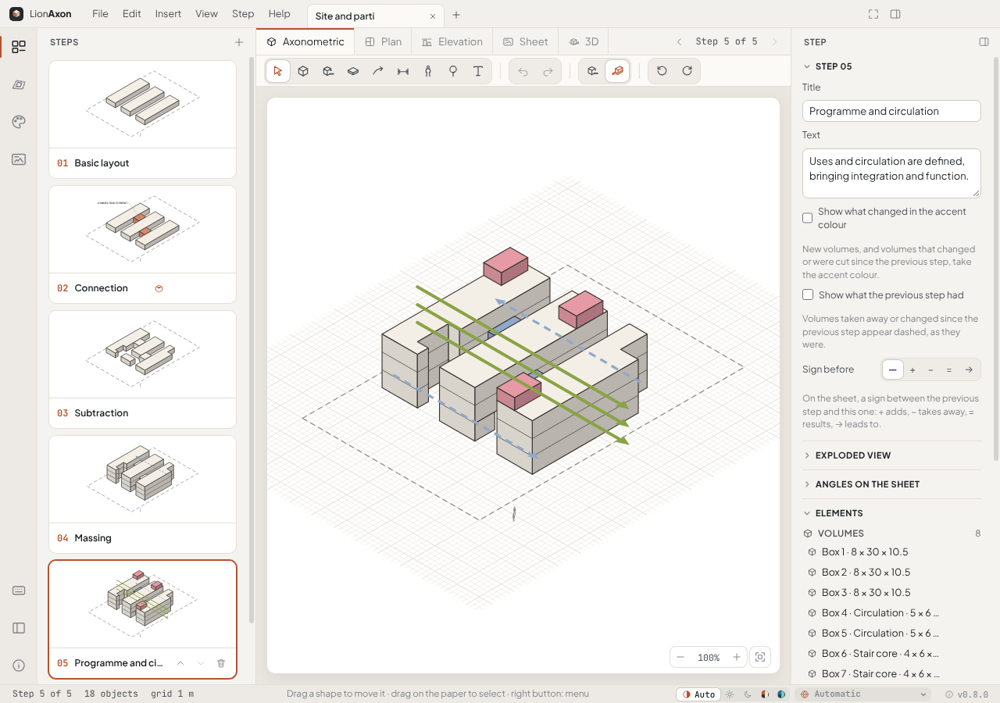

</div>

## What it is for

Every architecture project starts with the same question: *why does the building have this shape?* The answer is usually a row of small drawings — the site, the first block, what was cut, what was stacked, where people walk — and it is usually made by fighting a 3D modeller, a vector editor and a layout program at once.

**LionAxon does that one job, start to finish.** You draw simple volumes on a site, tell the story in steps, and get a clean vector sheet: PDF, SVG or PNG. Nothing else to learn, nothing else to install.

<table>
<tr>
<td width="33%" valign="top">

### Simple

Nine tools and one idea: *each step is a copy of the one before; change only what that step tells.* What changed takes the accent colour by itself. No layers, no cameras, no render settings.

</td>
<td width="33%" valign="top">

### Everywhere

One app, identical on **Windows, macOS and Linux**, in **ten languages**. A project is a single small text file that opens the same on any of them — send it to a colleague, keep it in git.

</td>
<td width="33%" valign="top">

### Yours

Free software (GPL-3.0). No account, no subscription, no telemetry, and it works offline. The diagrams and sheets you make are yours.

</td>
</tr>
</table>

## A diagram in four moves

| | |
|---|---|
| **1 · Draw volumes on the site.** Drag a rectangle, pull its height. Boxes, cylinders, spheres, cones, pyramids, or any outline point by point. Type the numbers if you prefer. | 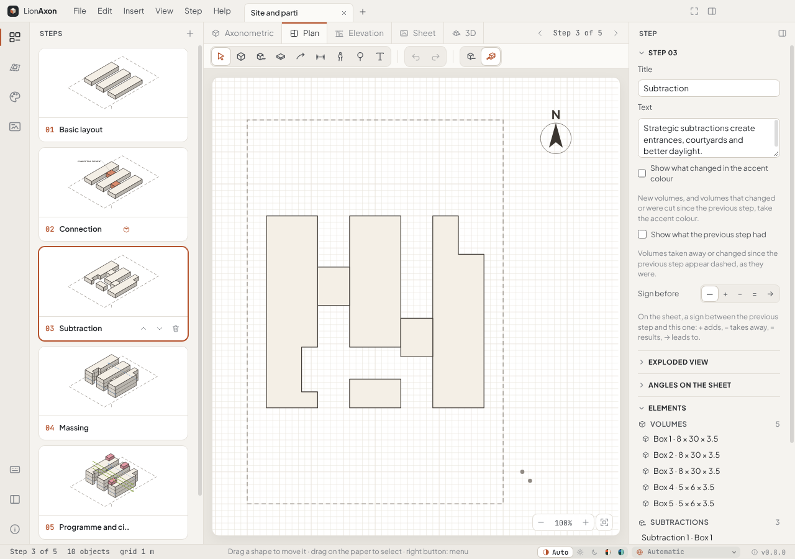 |
| **2 · Subtract and stack.** Open a notch or a passage; start on a roof to stack. The subtraction stays an object: move it later. | 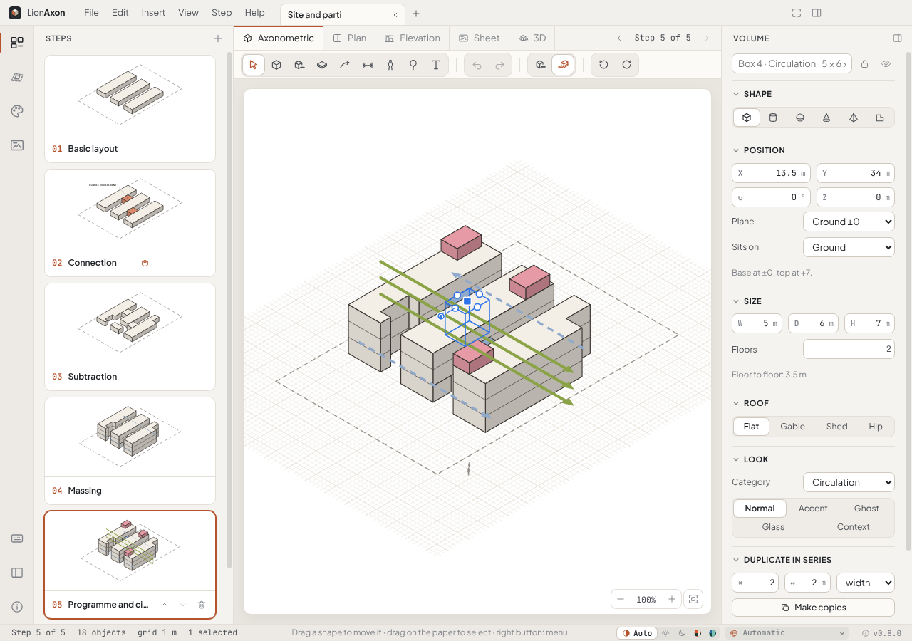 |
| **3 · Add a step.** It starts as a copy. What you change shows in the accent colour; the previous step can stay as a dashed ghost. | 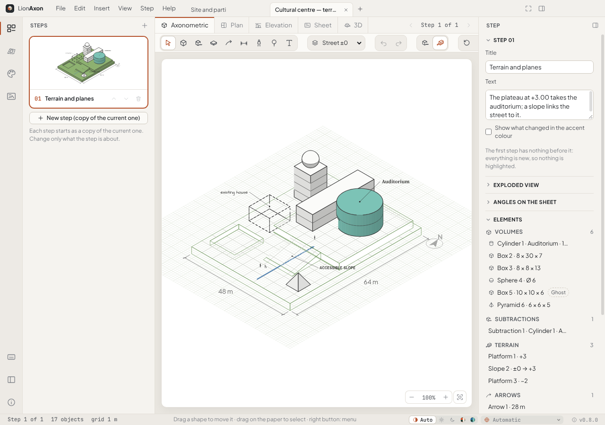 |
| **4 · Open the sheet.** Every step at the same scale, with title, texts, legend, north and scale bar. Export and print. | 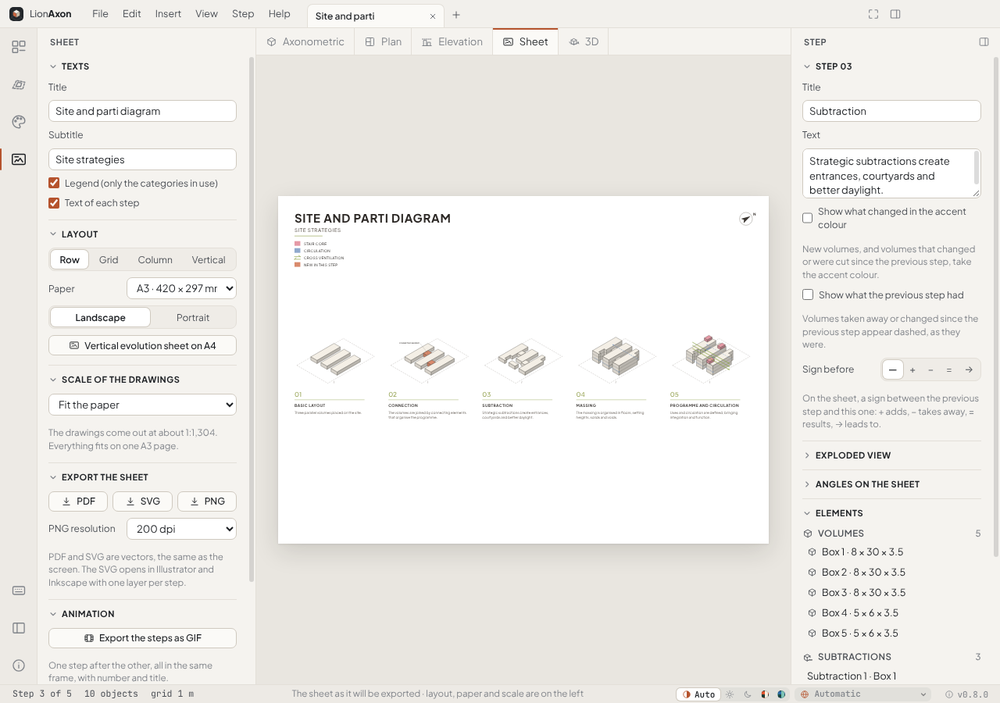 |

## What you get

**Tell the story**
- **Steps** with title and text, reordered by dragging; changes applied to the following steps with one click; signs between steps (+ − = →).
- **Categories** with colour *and* hatch (circulation, stair core, theatre…), so the legend reads in grey print and for people who do not tell colours apart.
- **Arrows, people, labels, dimension lines and trees** — people at their real height, to give the scale.

**Shape the site**
- **Terrain**: platforms, slopes, pits, reference planes with level lines in the elevation; a site of any outline.
- **Surroundings**: neighbours in neutral grey, streets, lawns, water, and a site plan or aerial photo underneath to draw over.
- **Sun and shadows** by latitude, day and hour. **Roofs**: gable, shed and hip.

**See it from anywhere**
- **Axonometric, plan and four elevations**, with **sections**.
- A **3D viewer** that turns all the way round — and where you can **select, move and pull heights** too. A blue frame tells you that you are in it.
- **Exploded views**, and one step **seen from several angles side by side** on the sheet.

**Take it out**
- **PDF and SVG in vectors** (one layer per step in Illustrator and Inkscape), **PNG** up to 300 dpi, the steps as an **animated GIF**.
- Sheets in row, grid, column or vertical layouts, A4 to A1, to scale, on as many pages as needed.
- **Eight drawing styles**, light and dark interface, and two coloured themes.

<table>
<tr>
<td>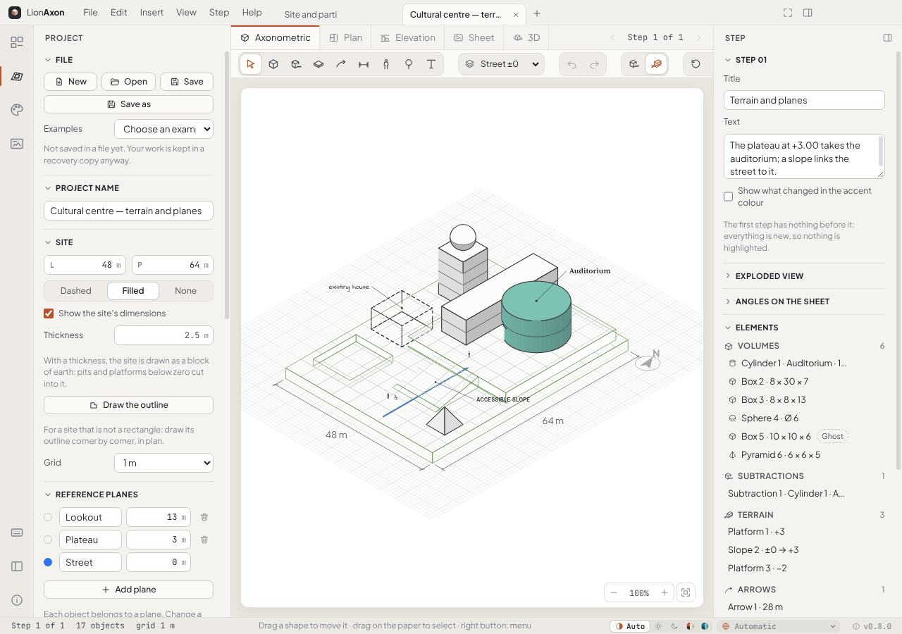<br><sub>Terrain, reference planes and curved volumes</sub></td>
<td>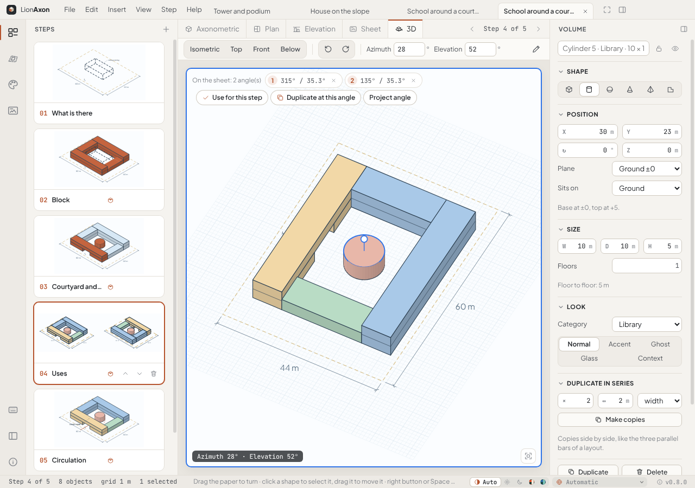<br><sub>The 3D viewer: turn, select, move, pull the height</sub></td>
</tr>
<tr>
<td>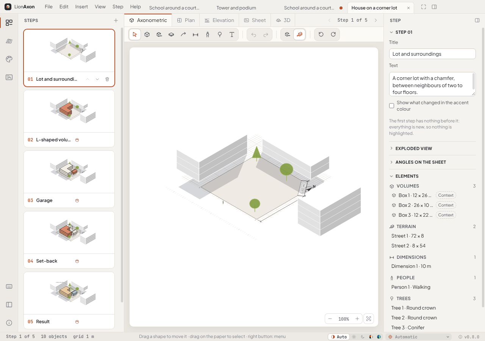<br><sub>Surroundings, trees, sun and shadows</sub></td>
<td>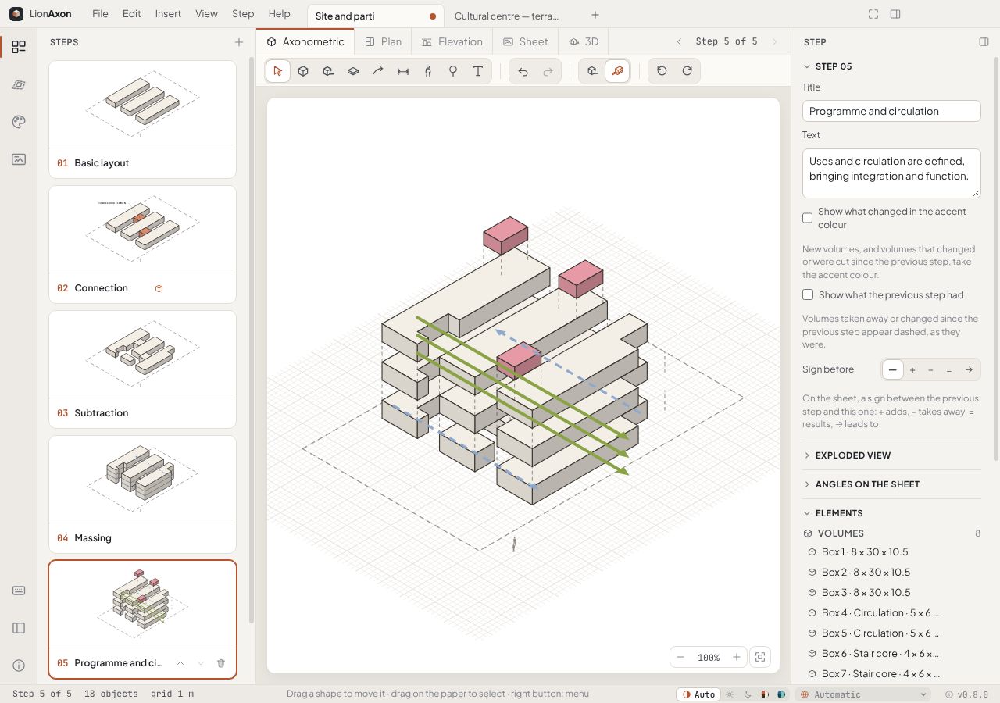<br><sub>Exploded views</sub></td>
</tr>
<tr>
<td>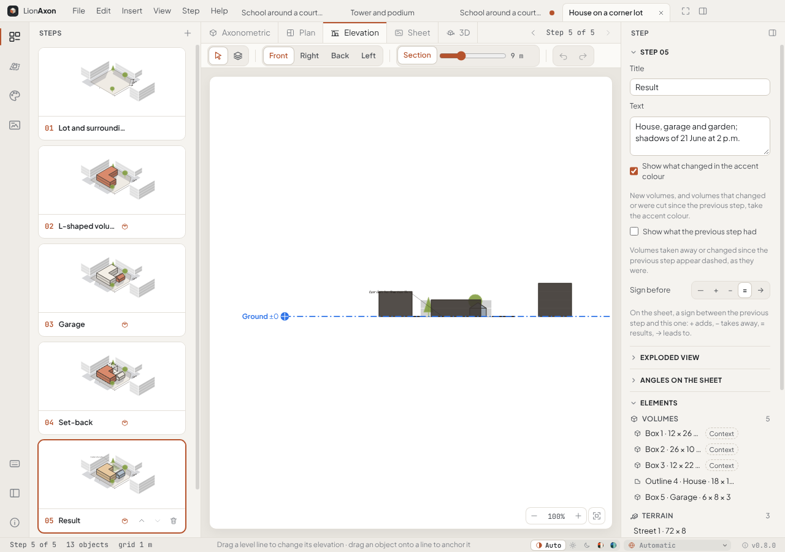<br><sub>Elevations and sections</sub></td>
<td>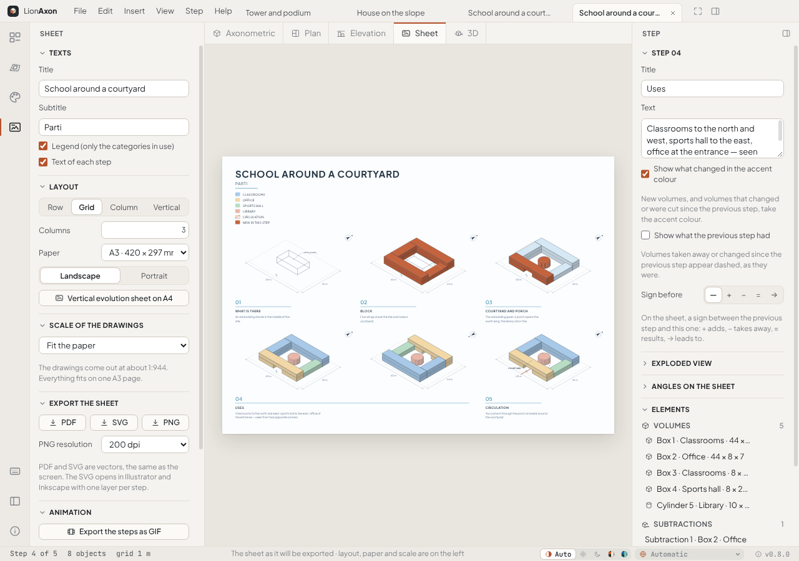<br><sub>One step, several angles, one sheet</sub></td>
</tr>
<tr>
<td>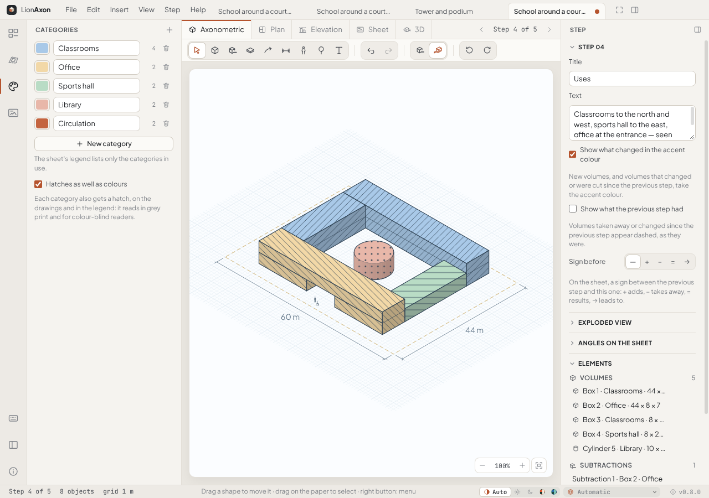<br><sub>Categories with colour and hatch</sub></td>
<td>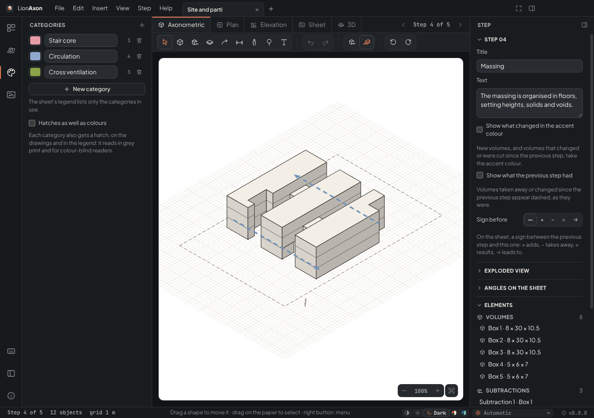<br><sub>Light and dark themes</sub></td>
</tr>
</table>

## Runs where you work

| | |
|---|---|
| **Systems** | Windows 10 and 11 · macOS · Linux — the same interface, the same shortcuts, the same files |
| **Languages** | English · Português (Brasil) · Português (Portugal) · Español · Français · Deutsch · Italiano · 简体中文 · 日本語 · 한국어 — the app follows the system language, or the one you pick in the status bar |
| **Files** | One `.lionaxon` file per project: readable JSON, a few kilobytes, with any image underneath kept inside |
| **Offline** | Everything works without a network. The only connection is the version check, and only when you ask for it |

The examples that come with the app are in English and Portuguese; in the languages other than these two they open in English. The translations other than English and Brazilian Portuguese were made without native review yet: corrections are welcome.

## Get started

LionAxon is **experimental** (version 0.8): it already makes a whole parti diagram and exports it, but the file format and the behaviour may still change before 1.0.

**Installers.** A GitHub Actions workflow (`.github/workflows/release.yml`) builds installers for Windows, macOS and Linux when a version tag is pushed. They are not signed yet, so the system will ask for confirmation on the first run. Look for them under *Releases*.

**From the source**, with [Node.js](https://nodejs.org) (LTS):

```sh
npm install
npm start
```

On Windows you can also double-click **`start.bat`** (the first run installs what is needed).

The app opens on a start screen with six examples — from the five-step parti that inspired the app to a house on a corner lot. Change them freely, or start a new diagram with **Ctrl+N**.

<div align="center">
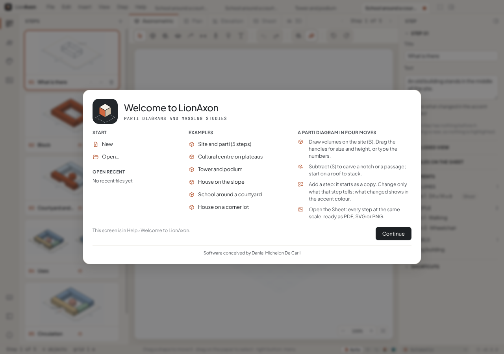
</div>

## Keyboard shortcuts

| Shortcut | Action |
|---|---|
| `V` `B` `S` `G` `A` `P` `T` | Select · volume · subtract · terrain · arrow · person · label |
| `D` · `E` | Dimension line · tree |
| `Enter` · double-click | End an outline drawn point by point |
| `N` | New reference plane (in the elevation) |
| `Delete` · `Ctrl+D` | Delete · duplicate the selection |
| `Ctrl+C` · `Ctrl+X` · `Ctrl+V` | Copy · cut · paste (also to another step or diagram) |
| `0`–`9` with a shape selected | Type its size: width × depth × height |
| `F2` · `Ctrl+L` · `Ctrl+H` | Rename · lock · hide the selection |
| Right button | The menu of the object (or of the paper) |
| `R` · `Space` · `Shift` | Turn the selection 90° (`Shift`: 15°); `Space` also while moving; hold `Space` and drag to pan |
| `←` `→` `↑` `↓` | Move the selection by the grid (`Shift`: 0.1 m) |
| `Ctrl+Z` · `Ctrl+Y` | Undo · redo |
| `F` | Fit the drawing |
| Drag on the paper | Select with a rectangle (`Shift` adds) |
| Wheel · `Ctrl` `+` `−` `0` | Zoom in and out · fit |
| `Space` + drag · middle or right button | Pan |
| `Ctrl+\` | Only the drawing (hide the panels) |
| `Alt` while dragging | Leave the grid |
| `Alt` · `F10` | The menu bar (arrows to move, `Enter` to run, `Esc` to close) |
| `PgUp` · `PgDn` | Previous · next step |
| `Ctrl+1` `2` `3` `4` `5` | Axonometric · plan · elevation · sheet · 3D viewer |
| In the 3D viewer: drag on the paper · `←` `→` `↑` `↓` · `I` | Turn all the way round · turn 15° (`Shift`: 5°) · isometric |
| In the 3D viewer: click · drag a shape · the round handle · `Delete` | Select · slide it on the ground · pull its height · delete |
| `Ctrl+N` · `Ctrl+O` · `Ctrl+S` · `Ctrl+Shift+S` | New · open · save · save as |
| `Ctrl+W` · `Ctrl+Tab` | Close the diagram · next diagram (`Shift`: previous) |
| `Esc` | Back to select, clear the selection |

## How it works

**A 2.5D model.** A volume is a footprint (a rectangle or an ellipse, turned at any angle) extruded between a base height and a top, with a number of floors; cones and pyramids end in a point, spheres are drawn as spheres. A subtraction is a box with its own heights; the volume is cut in height bands and each band's footprint loses the cuts that cover it (boolean operations on polygons, rounded to 1 mm). Heights are counted from the object's reference plane. This covers boxes, notches, passages, stacks, courtyards, floors and terrain, and keeps editing simple.

**A vector renderer of its own.** Faces are projected in parallel (isometric by default), ordered back to front with plane tests between the faces that overlap on screen (Newell) — a face that crosses another is cut by its plane, and only the line where they meet is drawn — and written as SVG; curved surfaces are drawn without the seams between their facets. The same SVG is the screen, the thumbnails, the sheet and the exported files: what you see is what you export. Walls get two tones from the same colour and tops stay lighter, as in hand-made diagrams. 200 volumes are drawn in a few tens of milliseconds.

**Steps are whole scenes.** Each step keeps every object; an object keeps the same id from one step to the next. That is how the app knows what changed.

## The file

A project is one `.lionaxon` file: indented JSON with a `schemaVersion`, readable and easy to compare in git.

```jsonc
{
  "format": "lionaxon", "schemaVersion": 2, "name": "…",
  "site": { "w": 40, "d": 60, "mode": "dashed", "dims": true, "thickness": 0 },   // "pts": [[0,0],[40,0],…] for a site of any outline
  "sun": { "on": false, "lat": -30, "month": 6, "day": 21, "hour": 15, "opacity": 0.2 }, "underlay": null,
  "levels": [{ "id": "L0", "name": "Street", "z": 0 }, { "id": "L1", "name": "Plateau", "z": 3 }],
  "north": 0, "northPlace": "header", "northHalftone": false, "grid": 1, "style": "beige", "view": { "az": -45 },
  "categories": [{ "id": "k-circ", "name": "Circulation", "color": "#8fa9cc" }],
  "steps": [{ "id": "s-1", "title": "…", "text": "…", "highlight": true, "explode": { "on": false, "gap": 4, "floors": false }, "views": [{ "az": 315, "el": 35.2644 }, { "az": 135, "el": -20 }], "objects": [
    { "type": "volume", "id": "v-west", "shape": "box", "x": 7, "y": 30, "w": 8, "d": 30, "h": 10.5, "rot": 0, "level": "L0", "z": 0, "on": null, "floors": 3, "cat": null, "state": "normal", "name": "West bar" },
    { "type": "cut", "id": "c-passage", "shape": "box", "x": 20, "y": 22, "w": 10, "d": 5, "level": "L0", "z": 0, "h": 3.5, "rot": 0, "target": "v-mid" },
    { "type": "platform", "id": "g-plateau", "x": 30, "y": 44, "w": 20, "d": 30, "rot": 0, "level": "L1", "z": 0 },
    { "type": "slope", "id": "r-ramp", "x": 30, "y": 20, "w": 8, "d": 14, "rot": 0, "from": "L0", "zFrom": 0, "to": "L1", "zTo": 0 }
  ] }],
  "sheet": { "layout": "vertical", "paper": "A4", "orientation": "portrait", "scale": 500, "title": "…", "subtitle": "…", "legend": true, "texts": true }
}
```

Other objects: `area` (a flat street, lawn, water or paving), `tree`, `dim` (a dimension line), and volumes or cuts with `"shape": "poly"` and their `pts`; a box may have `roof` and `roofH`; a step may have `ghostPrev` and `op`.

Measures are in metres, angles in degrees; `x`, `y` is the centre of a volume; `z` is the height over its plane (`level`); `on` is the volume it sits on. Files of 0.1 (`schemaVersion` 1) open as they are, with everything on the ground plane.

## For agents and scripts

A command describes a project as JSON (schema 2) without opening the app and without changing anything — steps, counts, footprint and floor area, highest point, what changed in each step, volumes outside the site:

```sh
node tools/inspect.mjs examples/parti-en.lionaxon            # the whole project
node tools/inspect.mjs examples/parti-en.lionaxon --step 3   # one step
node tools/inspect.mjs project.lionaxon --objects            # with every object
node tools/inspect.mjs project.lionaxon --svg 2 > step2.svg  # the drawing of step 2
```

Every change in the app goes through named commands (`object.add`, `object.move`, `step.add`…), the base for a command palette and for agents in the next versions.

## Architecture

Same layering as [LionOrganizer](https://github.com/danielcarli/lionorganizer), [LionPhotos](https://github.com/danielcarli/lionphotos) and [Visual Studio Code](https://github.com/microsoft/vscode): `base` knows nothing above it, `platform` provides main-process services, `workbench` builds the interface. The main process (Node.js) and the interface (a sandboxed renderer without Node access) only talk through the `preload` bridge.

```
src/
  base/
    common/              events, i18n (nls.js)
      geometry/          parallel projection, polygons (booleans through polygon-clipping)
    browser/             DOM helpers, icons
  platform/              main-process services
    project/             open and save .lionaxon files, examples, recovery copy
    export/              write SVG and PNG, print the PDF (hidden window, fonts embedded)
    update/ · nls/       version check (only when asked), i18n for the main process
  code/
    electron-main/       entry point: window, app:// protocol, service wiring
    electron-sandbox/    preload bridge
  nls/                   message catalogs, one per language (ten), and locales.json
  vendor/                polygon-clipping (MIT), as one ES module
  workbench/
    browser/             layout parts, dialogs, form controls, styles
    services/
      model/             the project model (pure data): planes, volumes, cuts, terrain, arrows, people, labels, steps
      render/            the vector renderer and its solids, the sheet, the drawing styles, the fonts
      document/          open diagrams (tabs), current step, selection, active plane, undo, session copy
      commands/          the named commands
      export/ · layout/ · notification/ · dialog/ · update/
    contrib/             drawing (axonometric, plan and elevation, tools, handles), the 3D viewer (orbit: look from any angle, select, move, pull heights), properties, steps, project, categories, sheet
examples/                the six example projects, in English and Portuguese
tools/                   tests, the inspector, the example builder
```

Security: `contextIsolation` and `sandbox` on, no `nodeIntegration`, a strict Content Security Policy. The main process only writes where the person chose in a native dialog, or to the file they opened.

Privacy: no account, no telemetry. LionAxon uses the network only when you click the version (bottom-right corner) and press *Check now*.

## Development

| Command | What it does |
|---|---|
| `npm start` | Run the app |
| `npm test` | Unit tests (projection, polygons, model, renderer order, sheet) and the i18n check |
| `npm run test:e2e` | End-to-end test on a **disposable** folder, with the real mouse and keyboard: draw, move, height and rotation handles, floors, subtract, shapes, planes, terrain, steps, arrow, person, label, delete a step and undo, tabs, the save question on closing, save, reopen, export PDF/SVG/PNG, then restart and check the session (on Linux without a screen: `xvfb-run -a npm run test:e2e`) |
| `npm run shots` | The screenshots of this README (`-- --lang=pt-BR --out=docs/screenshots/pt-BR` for another language) |
| `npm run inspect -- <project.lionaxon>` | Describe a project as JSON |
| `npm run examples` | Rebuild the example projects |
| `npm run dist` | Build installers with electron-builder (the release workflow does it for the three systems) |

Code, comments, identifiers and documentation are in English. The interface is translated in `src/nls/<language>.json`; `npm test` fails if a language misses a key or a placeholder. To add a language, copy `en.json`, translate it and add a line to `src/nls/locales.json`.

## Roadmap

- **0.8** ✓ — the interface in ten languages; editing in the 3D viewer (select, move, heights) inside a frame of its own; code identifiers all in English, with old files still opening.
- **0.7** ✓ — outlines of any shape; surroundings; sun and shadows; roofs; dimension lines; ghosts and signs between steps; sections; the steps as GIF; a workflow that builds the installers.
- **0.6** ✓ — usability: copy and paste, a right-button menu, a selection rectangle, align and guides, typed sizes, names, lock and hide, a start screen, recent files, hatches for categories.
- **0.5 – 0.1** ✓ — the 3D viewer and several angles per step; a menu bar and examples; elevations, exploded views and vertical sheets; terrain, reference planes and curved shapes; tabs; the first volumes, steps and sheet.
- **0.9** — courtyards and joining volumes; loose slabs and pilotis; shadows on volumes and terrain; sections on the sheet; drawing new shapes in the 3D viewer; a command palette; signed installers.
- **1.0** — DXF in and out; a manual and tutorials in the order of a design studio; reviewed translations.

## Changelog

See [CHANGELOG.md](CHANGELOG.md) — current version: **0.8.0**.

## Credits

LionAxon was **created and conceived by Daniel Michelon De Carli**, an architecture and urbanism student, and is maintained by the **LionAxon Team** together with its contributors and translators.

The first example recreates, with simple volumes, the five steps of a parti diagram used as a reference while designing the app.

In the app, the credits are in *Help › Credits*.

## License

LionAxon is free software under the **GNU General Public License v3.0 or later** — see [LICENSE](LICENSE). The licence covers the program, not the diagrams and sheets you make with it: they are yours.

Third-party components and their licences are listed in [THIRD-PARTY-NOTICES.md](THIRD-PARTY-NOTICES.md).
