<div align="center">


# LionAxon

### A ideia do seu projeto, contada em blocos.

**Diagramas de partido e estudos de volume para arquitetura — do primeiro volume à prancha impressa.**<br>
Simples de aprender em uma tarde. O mesmo programa no Windows, no macOS e no Linux. Livre.

<sub>pelo <b>LionAxon Team</b> · criado e idealizado por <b>Daniel Michelon De Carli</b> · da família Lion, com o <a href="https://github.com/danielcarli/lionorganizer">LionOrganizer</a> e o <a href="https://github.com/danielcarli/lionphotos">LionPhotos</a></sub>

[English](../README.md) · **Português (Brasil)**


<p>
  <a href="https://github.com/danielcarli/lionaxon/releases/latest/download/LionAxon-Setup.exe"></a>
  <a href="https://github.com/danielcarli/lionaxon/releases/latest/download/LionAxon-mac-universal.dmg"></a>
  <a href="https://github.com/danielcarli/lionaxon/releases/latest/download/lionaxon_amd64.deb"></a>
  <a href="https://github.com/danielcarli/lionaxon/releases/latest/download/lionaxon.x86_64.rpm"></a>
  <a href="https://github.com/danielcarli/lionaxon/releases/latest/download/LionAxon-x86_64.AppImage"></a>
</p>

<sub><a href="https://github.com/danielcarli/lionaxon/releases">Todas as versões</a> · <a href="#baixar">Como instalar</a></sub>

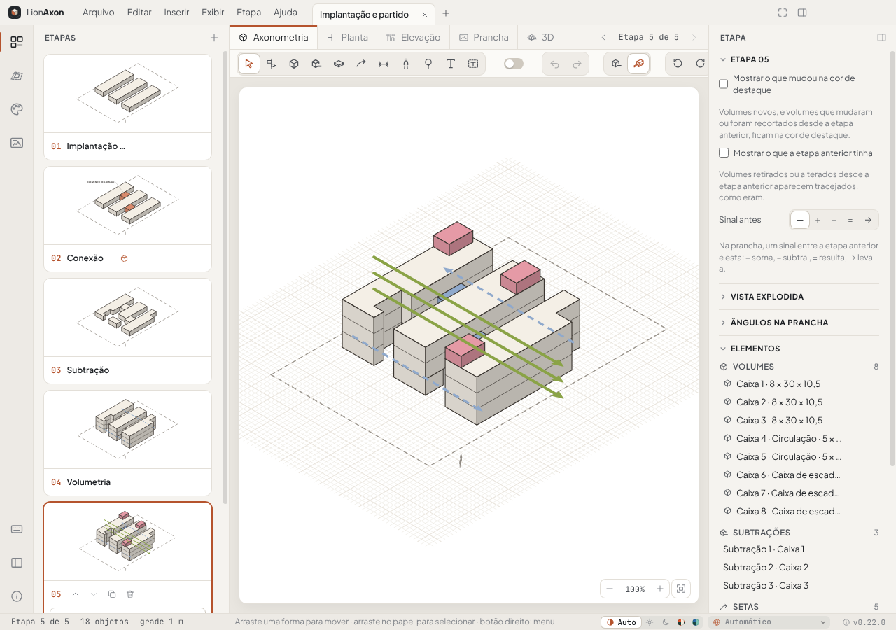

</div>

## Para que serve

Todo projeto de arquitetura começa com a mesma pergunta: *por que o edifício tem essa forma?* A resposta costuma ser uma fileira de desenhos pequenos — o terreno, o primeiro bloco, o que foi recortado, o que foi empilhado, por onde as pessoas andam — e costuma ser feita brigando com um modelador 3D, um editor vetorial e um programa de diagramação ao mesmo tempo.

**O LionAxon faz esse único trabalho, do começo ao fim.** Você desenha volumes simples sobre o terreno, conta a história em etapas e sai com uma prancha vetorial limpa: PDF, SVG ou PNG. Nada mais para aprender, nada mais para instalar.

<table>
<tr>
<td width="33%" valign="top">

### Simples

Dez ferramentas e uma ideia: *cada etapa é uma cópia da anterior; mude só o que aquela etapa conta.* O que mudou ganha a cor de destaque sozinho. Sem camadas, sem câmeras, sem ajustes de render.

</td>
<td width="33%" valign="top">

### Em todo lugar

Um programa só, idêntico no **Windows, no macOS e no Linux**, em **dez línguas**. O projeto é um único arquivo de texto, pequeno, que abre igual em qualquer um deles — mande para um colega, guarde no git.

</td>
<td width="33%" valign="top">

### Seu

Software livre (GPL-3.0). Sem conta, sem assinatura, sem telemetria, e funciona sem internet. Os diagramas e pranchas que você faz são seus.

</td>
</tr>
</table>

## Um diagrama em quatro movimentos

| | |
|---|---|
| **1 · Desenhe volumes no terreno.** Arraste um retângulo, puxe a altura. Caixas, cilindros, esferas, cones, pirâmides, trapézios em pé ou deitados, ou qualquer contorno ponto a ponto. Se preferir, digite os números. | 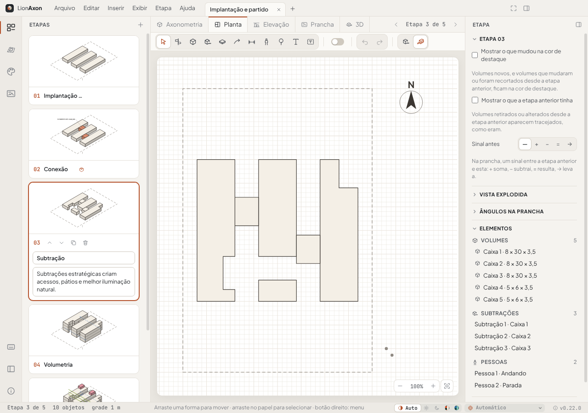 |
| **2 · Recorte e empilhe.** Abra um entalhe ou uma passagem; comece sobre uma cobertura para empilhar. O recorte continua sendo um objeto: mova depois. | 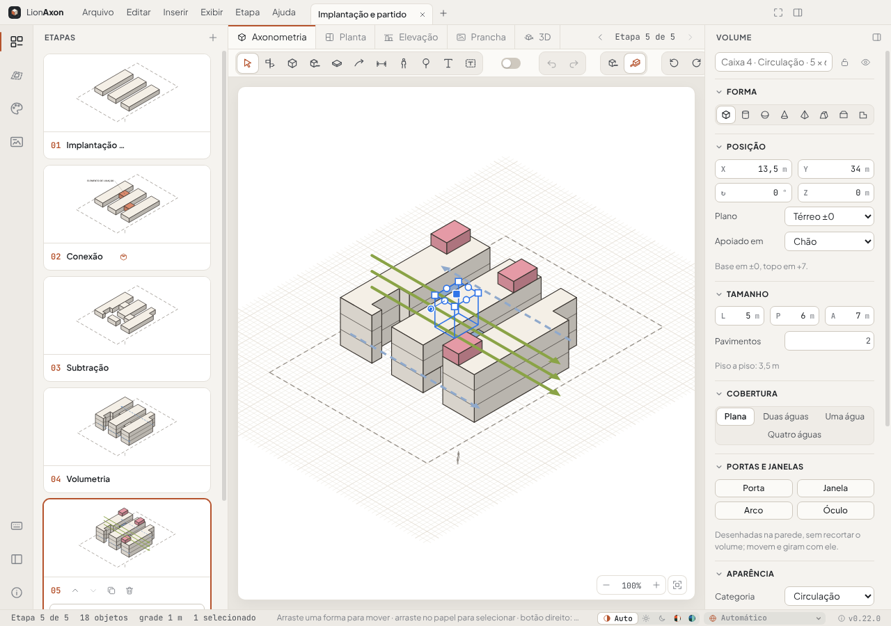 |
| **3 · Acrescente uma etapa.** Ela começa como cópia. O que você muda aparece na cor de destaque; a etapa anterior pode ficar como fantasma tracejado. | 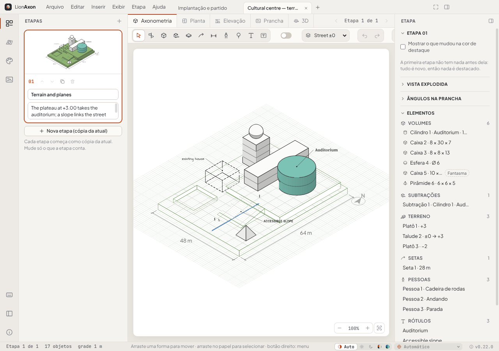 |
| **4 · Abra a prancha.** Todas as etapas na mesma escala, com título, textos, legenda, norte e escala gráfica. Exporte e imprima. | 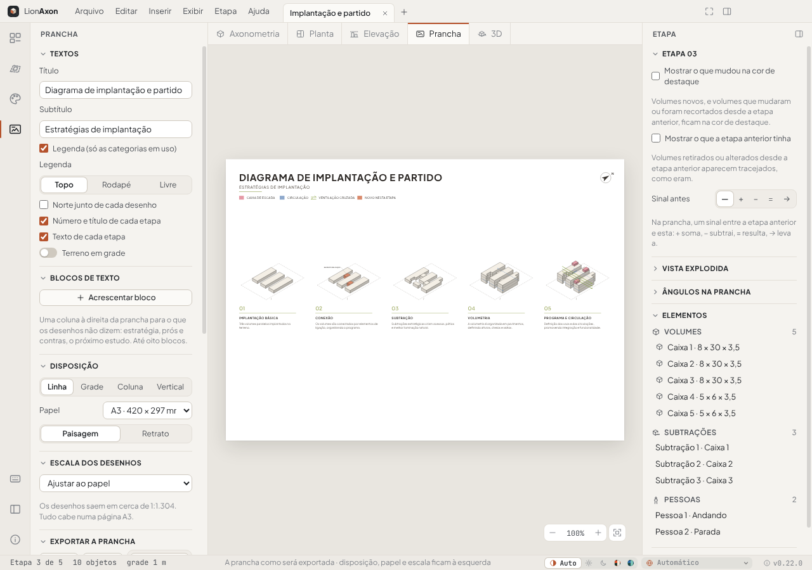 |

## O que vem junto

**Contar a história**
- **Etapas** com título e texto, escritos direto no card da etapa atual, reordenadas arrastando; mudanças aplicadas às etapas seguintes com um clique; sinais entre as etapas (+ − = →).
- **Categorias** com cor *e* hachura (circulação, núcleo de escada, teatro…): a legenda funciona em impressão cinza e para quem não distingue as cores.
- **Alinhar faces** (`L`): clique na face de referência e depois na face de outra forma, e ela se move até as duas ficarem no mesmo plano — lado com lado, topo com topo.
- **Setas, pessoas, rótulos, cotas e árvores** — as pessoas na altura real, para dar a escala (as ferramentas de pessoa e árvore continuam ativas: uma a mais a cada clique); pessoas e árvores ficam em cima do que estiver embaixo delas (um platô, um talude, uma cobertura). Duplo clique em um rótulo para escrever o texto — e o texto menor embaixo dele — direto no desenho, com **negrito**, *itálico* e listas. A **caixa de texto** é um rótulo sem linha: texto solto, numa caixa redimensionada pela lateral.
- **Textos alinhados**: arraste um texto perto de outro e ele se encaixa na lateral esquerda, no meio, na lateral direita, no topo ou na base, com uma guia rosa passando pelos dois (`Alt`: livre); selecione vários e *Alinhar* os põe em linha pelas caixas como estão desenhadas — esquerda, centro, direita, topo, meio, base — ou *Distribuir* deixa espaços iguais entre eles, na horizontal ou na vertical. Os textos se movem; os pontos das linhas de chamada ficam onde estão.

**Moldar o terreno**
- **Terreno**: platôs, taludes, fossos, planos de referência com linhas de nível na elevação; terreno de qualquer contorno. **Unir terrenos** (uma chave na barra de ferramentas do desenho) desenha platôs e taludes que se tocam como uma peça só, sem as linhas entre eles.
- **Entorno**: vizinhos em cinza neutro, ruas, gramados, água, e uma planta de situação ou foto aérea por baixo para desenhar por cima.
- **Sol e sombras** por latitude, dia e hora. **Telhados**: duas águas, uma água e quatro águas, com a cumeeira na direção que você quiser e cor própria.
- **Portas, janelas, arcos e óculos** desenhados nas paredes: acompanham o volume, sem recortá-lo.
- **Mover uma parede pela aresta**: numa caixa, contorno ou trapézio deitado selecionado, pegue a aresta de cima de uma parede e puxe para fora ou para dentro; arraste um canto para mudar o contorno.
- **Preencher um vazio**: uma subtração deixa um vazio que outra forma pode ocupar, inteiro ou em parte — *Preencher o vazio* na subtração, ou desenhar uma forma dentro dele. **Subtrair do terreno** também: um fosso no chão, um recorte numa plataforma.
- **Pisos com paginação**, e setas que sobem de um nível a outro.

**Ver de qualquer lugar**
- **Axonometria, planta e quatro elevações**, com **cortes**.
- Um **visualizador 3D** que gira em todas as direções — e onde também dá para **selecionar, mover, redimensionar e puxar alturas**, e ver as subtrações (um botão na barra dele). O mouse tem **dois modos, Rev e Sketch** (você escolhe), com um cubo de vistas no canto. Uma moldura azul avisa que você está nele.
- **Duplicar uma etapa** com um clique, para contar o próximo movimento a partir de onde o anterior parou.
- **`Tab` alcança o que está atrás**: o próximo objeto no mesmo ponto ganha um contorno de outra cor e o resto fica transparente.
- **Vistas explodidas**, e uma etapa **vista de vários ângulos lado a lado** na prancha.

**Levar embora**
- **PDF e SVG vetoriais** (uma camada por etapa no Illustrator e no Inkscape), **PNG** até 300 dpi, as etapas em **GIF animado**, e **cada etapa como imagem própria** (PNG, SVG ou PDF, todas no mesmo enquadramento e escala) de uma vez.
- **Blocos de texto** ao lado dos desenhos (estratégia, prós e contras com + e −), a **legenda** no topo, no rodapé ou **livre** (arrastada para qualquer lugar na prévia); um **norte junto de cada desenho**; rótulos com uma segunda linha mais discreta e marcadores (! × + −), que quebram em linhas na largura até onde você puxa a lateral da caixa de texto. O terreno pode ir para a prancha **em grade**, como na edição.
- **Desenhos do maior tamanho que o papel permite**: a grade escolhe sozinha o número de colunas, a legenda corre em linhas, e um terreno que não é desenhado não ocupa mais espaço.
- Pranchas em linha, grade, coluna ou vertical, de A4 a A0, em escala, em quantas páginas for preciso; quando os desenhos ficam presos pela altura, as legendas vão para o lado e os desenhos crescem. A prévia tem zoom pela roda e se arrasta como o desenho, página a página.
- Pranchas com ou sem o **número e o título** de cada etapa.
- **Exportar as etapas que você escrever** — `7`, `3-7`, `1, 4, 6-8`, `3-` até a última, `-5` desde a primeira — cada uma num arquivo próprio (na largura ou altura em pixels que você der), ou numa prancha só com elas. Os PNG saem com **fundo transparente**, a não ser que você desligue.
- **Oito estilos de desenho**, interface clara e escura e dois temas coloridos.

<table>
<tr>
<td>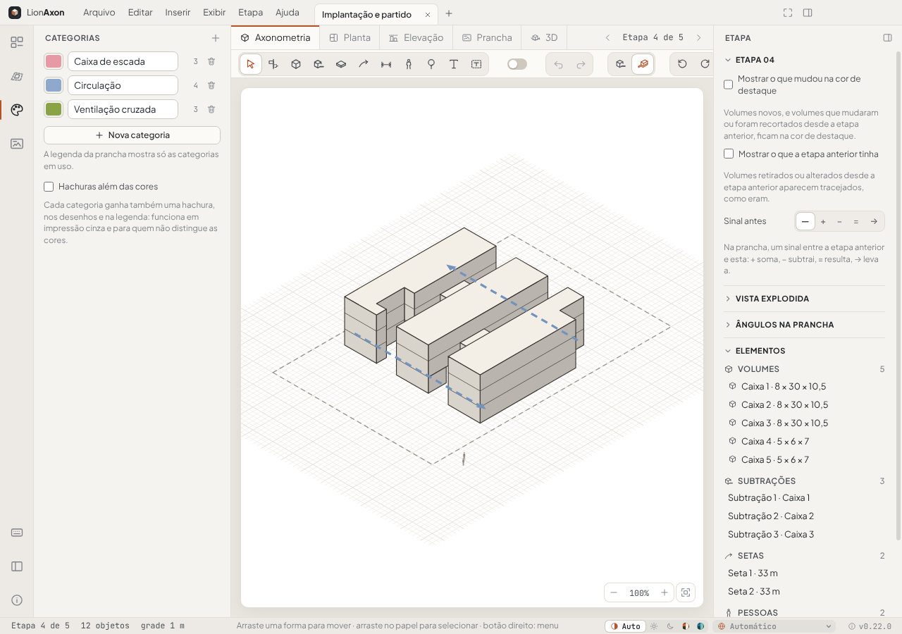<br><sub>Terreno, planos de referência e volumes curvos</sub></td>
<td>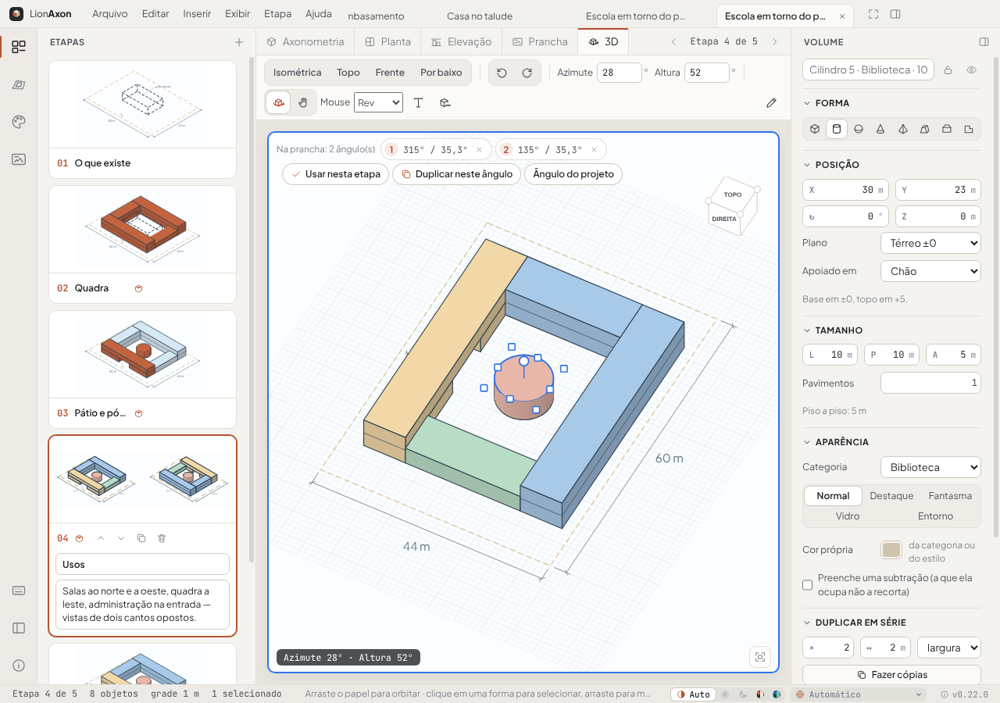<br><sub>O visualizador 3D: gire, selecione, mova, redimensione, puxe a altura</sub></td>
</tr>
<tr>
<td>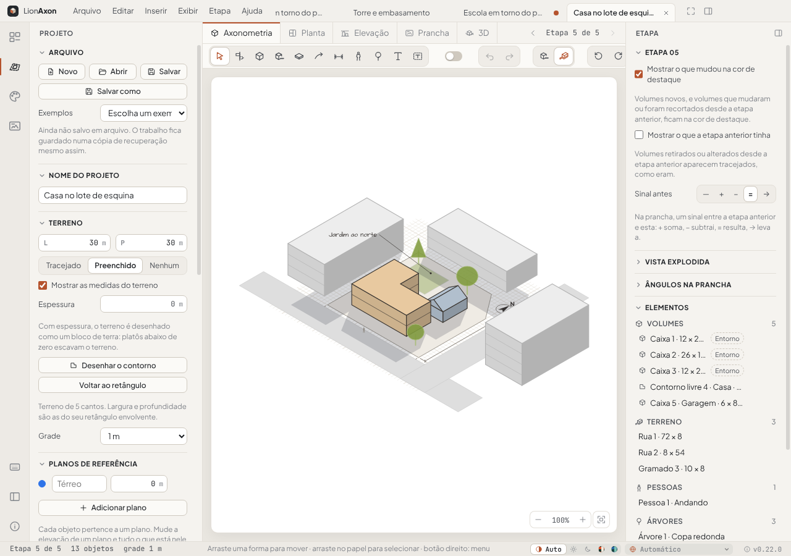<br><sub>Entorno, árvores, sol e sombras</sub></td>
<td>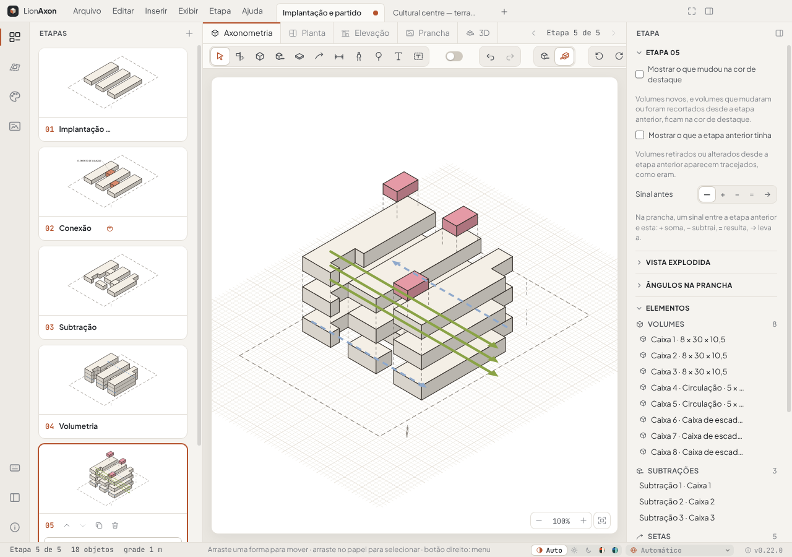<br><sub>Vistas explodidas</sub></td>
</tr>
<tr>
<td>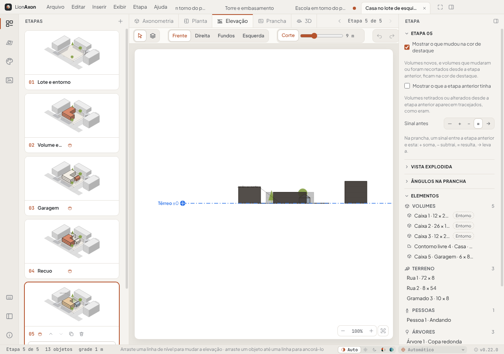<br><sub>Elevações e cortes</sub></td>
<td>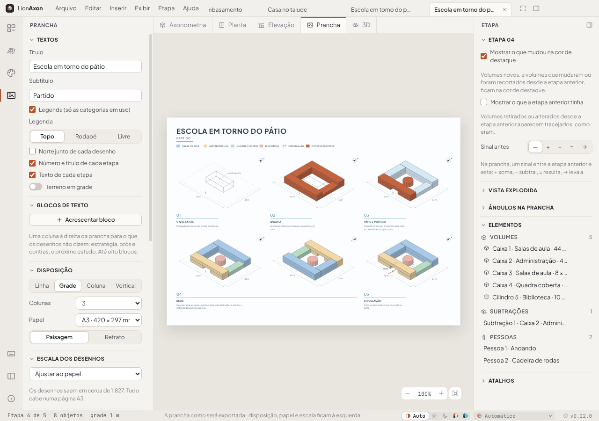<br><sub>Uma etapa, vários ângulos, uma prancha</sub></td>
</tr>
<tr>
<td>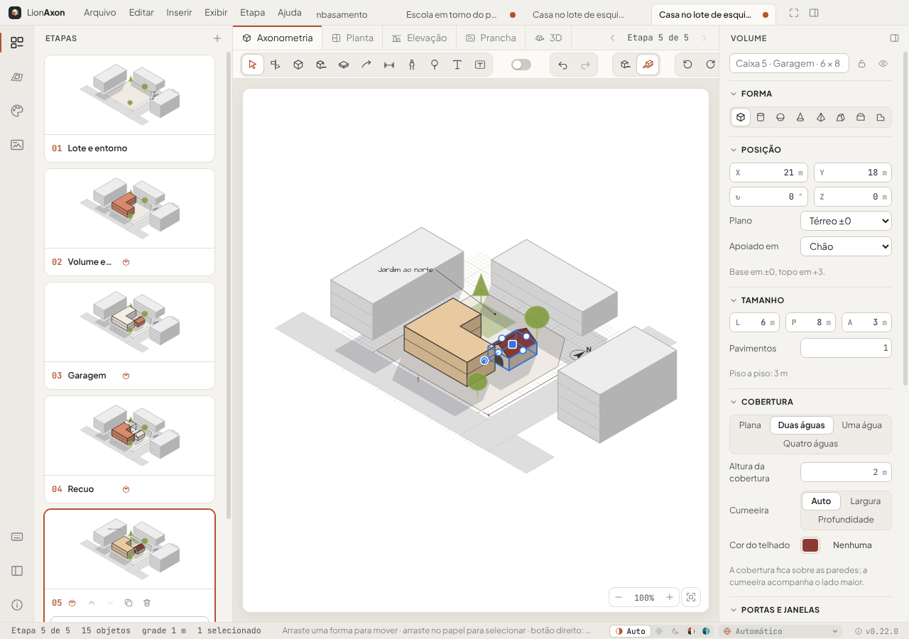<br><sub>Aberturas nas paredes, telhado com cor própria</sub></td>
<td>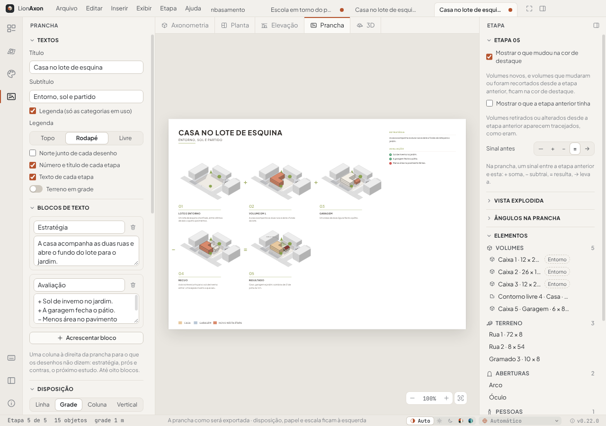<br><sub>Blocos de texto e legenda no rodapé</sub></td>
</tr>
<tr>
<td>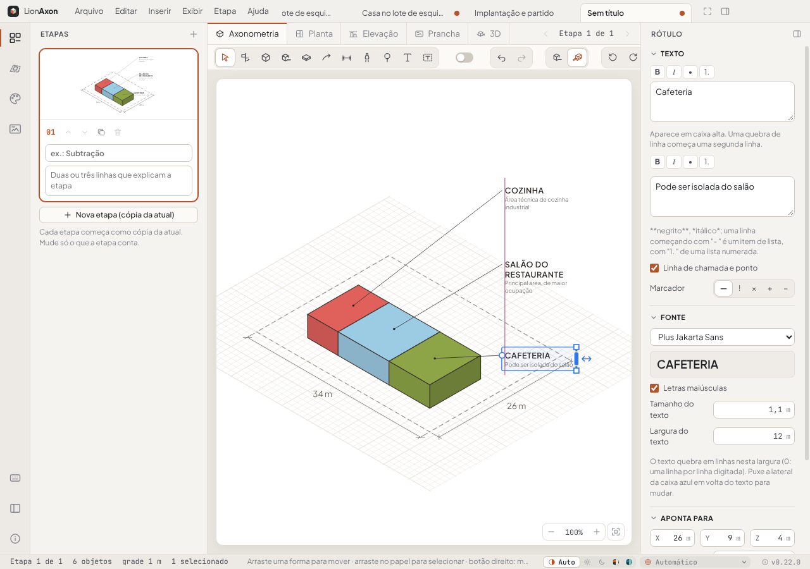<br><sub>Textos alinhados: a guia ao arrastar</sub></td>
<td>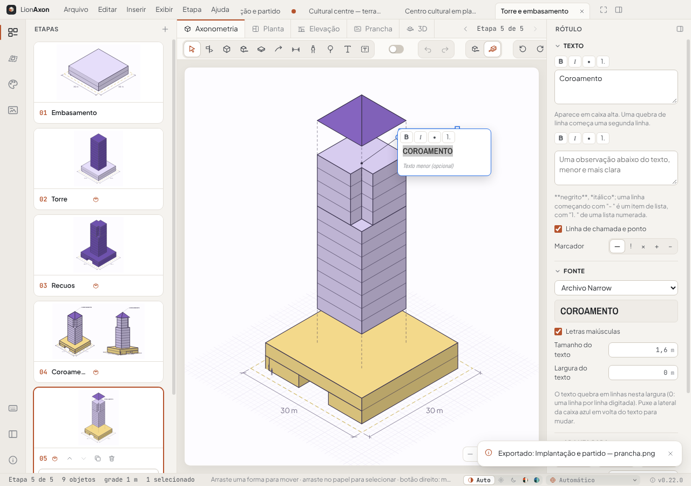<br><sub>Um rótulo escrito no desenho</sub></td>
</tr>
<tr>
<td>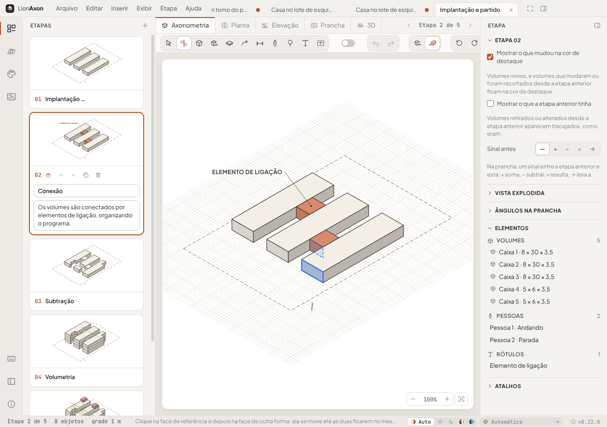<br><sub>Alinhar faces: a referência e depois a face que vai até ela</sub></td>
<td>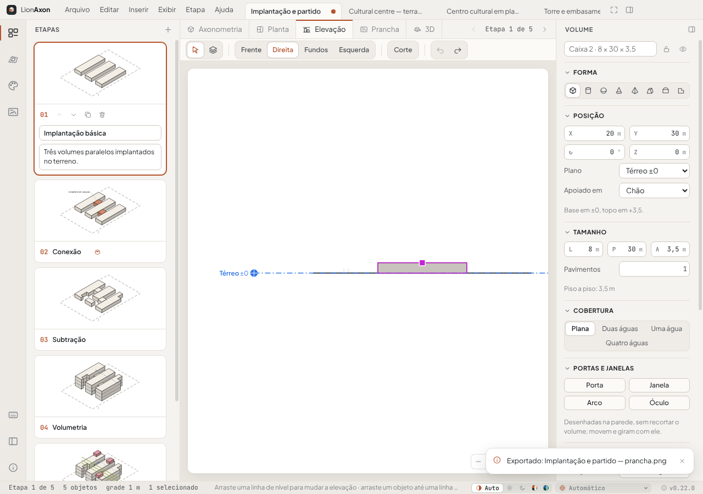<br><sub><code>Tab</code> alcança o que está atrás</sub></td>
</tr>
<tr>
<td>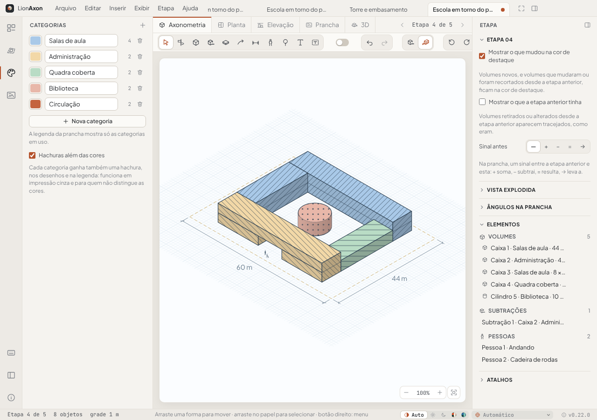<br><sub>Categorias com cor e hachura</sub></td>
<td>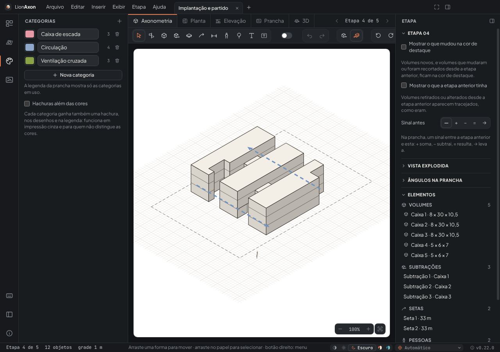<br><sub>Temas claro e escuro</sub></td>
</tr>
</table>

## Roda onde você trabalha

| | |
|---|---|
| **Sistemas** | Windows 10 e 11 · macOS · Linux — a mesma interface, os mesmos atalhos, os mesmos arquivos |
| **Línguas** | English · Português (Brasil) · Português (Portugal) · Español · Français · Deutsch · Italiano · 简体中文 · 日本語 · 한국어 — o programa segue a língua do sistema, ou a que você escolher na barra de status |
| **Arquivos** | Um arquivo `.lionaxon` por projeto: JSON legível, de poucos kilobytes, com a imagem de fundo guardada dentro |
| **Sem internet** | Tudo funciona sem rede. As únicas conexões são a verificação de versão e a atualização, e só quando você clica |

Os exemplos que vêm com o programa estão em inglês e português; nas demais línguas eles abrem em inglês. As traduções além do inglês e do português do Brasil ainda não passaram por revisão de falantes nativos: correções são bem-vindas.

## Baixar

Baixe o instalador do seu sistema. Os links trazem sempre a **versão mais recente**; cada instalador já contém o programa inteiro, então nada mais é baixado durante a instalação.

- **Windows 10/11** (x64): um assistente de instalação que deixa escolher a pasta. → [`LionAxon-Setup.exe`](https://github.com/danielcarli/lionaxon/releases/latest/download/LionAxon-Setup.exe) · ou a versão portátil, sem instalação: [`LionAxon-win-x64.zip`](https://github.com/danielcarli/lionaxon/releases/latest/download/LionAxon-win-x64.zip)
- **macOS 12+** (Apple Silicon e Intel): abra o `.dmg` e arraste o LionAxon para Aplicativos. → [`LionAxon-mac-universal.dmg`](https://github.com/danielcarli/lionaxon/releases/latest/download/LionAxon-mac-universal.dmg)
- **Linux** (x64): `.deb` para Ubuntu, Debian, Mint…, `.rpm` para Fedora, RHEL, openSUSE…, ou o AppImage para qualquer distribuição, sem instalação. → [`.deb`](https://github.com/danielcarli/lionaxon/releases/latest/download/lionaxon_amd64.deb) · [`.rpm`](https://github.com/danielcarli/lionaxon/releases/latest/download/lionaxon.x86_64.rpm) · [AppImage](https://github.com/danielcarli/lionaxon/releases/latest/download/LionAxon-x86_64.AppImage)

> Os instaladores ainda não são assinados com um certificado pago. Na primeira execução, o Windows pode mostrar "O Windows protegeu o computador" (**Mais informações › Executar assim mesmo**) e o macOS pede para liberar o programa em **Ajustes do Sistema › Privacidade e Segurança › Abrir Mesmo Assim**. As somas de verificação de cada arquivo estão em [`SHA256SUMS.txt`](https://github.com/danielcarli/lionaxon/releases/latest/download/SHA256SUMS.txt).

O LionAxon é **experimental** (versão 0.22): já faz um diagrama de partido inteiro e exporta, mas o formato do arquivo e o comportamento ainda podem mudar antes da 1.0. **Atualizar pelo programa.** Clique no número da versão, no canto inferior direito, e em *Verificar agora*: se houver versão mais nova, *Atualizar agora* baixa o instalador da sua cópia (o assistente do Windows, o `.dmg`, o AppImage, o `.deb` ou o `.rpm`), confere o SHA-256 com o da release e abre. As duas coisas só acontecem quando você clica.

Os instaladores são gerados pelo GitHub Actions a cada tag de versão (`.github/workflows/release.yml`), em máquinas Windows, macOS e Linux, a partir do código deste repositório.

### A partir do código

Com o [Node.js](https://nodejs.org) (LTS):

```sh
npm install
npm start
```

No Windows também dá para dar dois cliques em **`start.bat`** (a primeira execução instala o que falta).

O programa abre em uma tela inicial com seis exemplos — do partido em cinco etapas que inspirou o programa a uma casa em lote de esquina. Mude à vontade, ou comece um diagrama novo com **Ctrl+N**.

<div align="center">
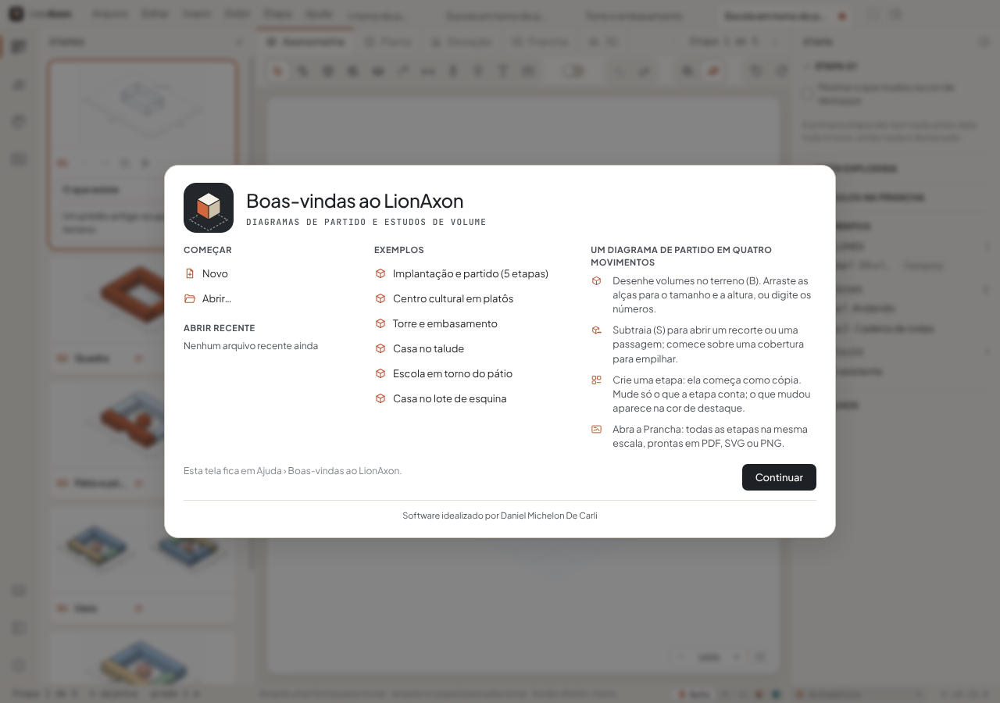
</div>

## Atalhos de teclado

| Atalho | Ação |
|---|---|
| `V` `B` `S` `G` `A` `P` `T` `X` | Selecionar · volume · subtrair · terreno · seta · pessoa · rótulo · caixa de texto |
| `N` | Novo plano de referência (na elevação) |
| `Delete` · `Ctrl+D` | Apagar · duplicar a seleção |
| `Ctrl+Shift+D` | Duplicar a etapa atual |
| `D` · `E` | Cota · árvore |
| `Enter` · duplo clique | Terminar um contorno desenhado ponto a ponto |
| `Ctrl+C` · `Ctrl+X` · `Ctrl+V` | Copiar · recortar · colar (também em outra etapa ou diagrama) |
| `0`–`9` com uma forma selecionada | Digitar o tamanho: largura × profundidade × altura |
| `L` | Alinhar faces: a face de referência e depois a face a levar até ela |
| `Tab` · `Shift+Tab` | O próximo · o anterior objeto no mesmo ponto (os outros ficam transparentes) |
| Arrastar a aresta de uma parede · um canto (forma selecionada) | Mover a parede para fora ou para dentro (`Shift`: qualquer direção) · mover o canto |
| Arrastar um texto perto de outro · `Alt` ao arrastar | Ele se alinha com o outro (uma guia rosa) · livre |
| Duplo clique em um rótulo · `Enter` com ele selecionado | Escrever o texto e o texto menor direto no desenho (`Enter` aplica, `Shift+Enter` nova linha, `Tab` o outro texto, `Ctrl+B` negrito, `Ctrl+I` itálico, `Esc` desiste) |
| `F2` · `Ctrl+L` · `Ctrl+H` | Renomear · travar · ocultar a seleção |
| Botão direito | Menu do objeto (ou do papel) |
| `R` · `Espaço` · `Shift` | Girar a seleção 90° (`Shift`: 15°); `Espaço` também ao mover; segure `Espaço` e arraste para deslocar |
| `←` `→` `↑` `↓` | Mover a seleção pela grade (`Shift`: 0,1 m) |
| `Ctrl+Z` · `Ctrl+Y` | Desfazer · refazer |
| `F` | Enquadrar o desenho |
| Arrastar no papel | Selecionar com um retângulo (`Shift` soma) |
| Roda · `Ctrl` `+` `−` `0` | Aproximar e afastar · enquadrar |
| `Espaço` + arrastar · botão do meio ou direito | Deslocar |
| `Ctrl+\` | Só o desenho (esconde os painéis) |
| `Alt` ao arrastar | Sair da grade |
| `Alt` · `F10` | A barra de menus (setas para andar, `Enter` para executar, `Esc` para fechar) |
| `PgUp` · `PgDn` | Etapa anterior · seguinte |
| Na prancha: roda · arrastar · `F` · `←` `→` | Zoom no mouse · mover o papel · enquadrar a página · página anterior · seguinte |
| `Ctrl+1` `2` `3` `4` `5` | Axonometria · planta · elevação · prancha · visualizador 3D |
| No visualizador 3D: arrastar no papel · `←` `→` `↑` `↓` · `I` | Girar em todas as direções · girar 15° (`Shift`: 5°) · isométrica |
| No visualizador 3D: clique · arrastar uma forma · as alças quadradas · a alça redonda · `Delete` | Selecionar · deslizar no chão · redimensionar · puxar a altura · apagar |
| No visualizador 3D: botão do meio · `Shift` + botão do meio · botão direito · roda · botão do meio duas vezes | Mover a vista · orbitar (o contrário no modo Sketch) · mover a vista (`Shift`: orbitar) · zoom no ponteiro · enquadrar |
| No visualizador 3D: `O` · `H` | Botão esquerdo orbita · botão esquerdo move a vista |
| `Ctrl+N` · `Ctrl+O` · `Ctrl+S` · `Ctrl+Shift+S` | Novo · abrir · salvar · salvar como |
| `Ctrl+W` · `Ctrl+Tab` | Fechar o diagrama · próximo diagrama (`Shift`: anterior) |
| `Esc` | Voltar a selecionar, limpar a seleção |

## Como funciona

**Um modelo 2,5D.** Um volume é um contorno em planta (um retângulo ou uma elipse, girado em qualquer ângulo) extrudado entre uma altura de base e um topo, com um número de pavimentos; cones e pirâmides terminam em ponta, o trapézio em pé inclina os lados (o deitado é um trapézio na planta), esferas são desenhadas como esferas. As alturas contam a partir do plano de referência do objeto. Uma subtração é uma caixa com suas próprias alturas; o volume é dividido em faixas de altura e cada faixa perde os recortes que a cobrem (operações booleanas entre polígonos, arredondadas a 1 mm). Isso cobre caixas, entalhes, passagens, pilhas, pátios e pavimentos, e mantém a edição simples.

**Um renderizador vetorial próprio.** As faces são projetadas em paralelo (isométrica por padrão), ordenadas de trás para a frente com testes de plano entre as faces que se sobrepõem na tela (Newell) e escritas em SVG. O mesmo SVG é a tela, as miniaturas, a prancha e os arquivos exportados: o que você vê é o que exporta. As paredes recebem dois tons da mesma cor e os topos ficam mais claros, como nos diagramas feitos à mão. 200 volumes são desenhados em algumas dezenas de milissegundos.

**As etapas são cenas inteiras.** Cada etapa guarda todos os objetos; um objeto mantém o mesmo id de uma etapa para a outra. É assim que o programa sabe o que mudou.

## O arquivo

Um projeto é um arquivo `.lionaxon`: JSON indentado com `schemaVersion`, legível e fácil de comparar no git. Medidas em metros, ângulos em graus; `x`, `y` é o centro do volume; `z` é a altura sobre o plano (`level`); `on` é o volume em que ele está apoiado. Arquivos da 0.1 (`schemaVersion` 1) abrem como estão, com tudo no plano térreo. O formato está descrito no [README em inglês](../README.md#the-file).

## Para agentes e scripts

Um comando descreve o projeto em JSON (esquema 2) sem abrir o programa e sem alterar nada — etapas, contagens, área de projeção e área construída, ponto mais alto, o que mudou em cada etapa, volumes fora do terreno:

```sh
node tools/inspect.mjs examples/parti-pt-BR.lionaxon            # o projeto inteiro
node tools/inspect.mjs examples/parti-pt-BR.lionaxon --step 3   # uma etapa
node tools/inspect.mjs projeto.lionaxon --objects               # com todos os objetos
node tools/inspect.mjs projeto.lionaxon --svg 2 > etapa2.svg    # o desenho da etapa 2
```

Toda alteração no programa passa por comandos com nome (`object.add`, `object.move`, `step.add`…), a base para a paleta de comandos e para agentes nas próximas versões.

## Arquitetura

As mesmas camadas do [LionOrganizer](https://github.com/danielcarli/lionorganizer), do [LionPhotos](https://github.com/danielcarli/lionphotos) e do [Visual Studio Code](https://github.com/microsoft/vscode): `base` não conhece nada acima dela, `platform` oferece os serviços do processo principal, `workbench` monta a interface. O processo principal (Node.js) e a interface (renderer em sandbox, sem acesso ao Node) só conversam pela ponte `preload`. A árvore de pastas está no [README em inglês](../README.md#architecture).

Segurança: `contextIsolation` e `sandbox` ligados, sem `nodeIntegration`, Content Security Policy estrita. O processo principal só grava onde a pessoa escolheu numa janela do sistema, ou no arquivo que ela abriu.

Privacidade: sem conta, sem telemetria. O LionAxon só usa a rede quando você clica na versão (canto inferior direito) e aperta *Verificar agora*.

## Desenvolvimento

| Comando | O que faz |
|---|---|
| `npm start` | Abre o programa |
| `npm test` | Testes unitários (projeção, polígonos, modelo, ordem do desenho, prancha) e a checagem dos idiomas |
| `npm run test:e2e` | Teste de ponta a ponta numa pasta **descartável**, com mouse e teclado de verdade: desenhar, mover, alças de altura e de rotação, pavimentos, subtrair, formas, planos, terreno, etapas, seta, pessoa, rótulo, apagar etapa com código, desfazer, abas, a pergunta ao fechar, salvar, reabrir, exportar PDF/SVG/PNG, e então reabrir o programa e conferir a sessão (no Linux sem tela: `xvfb-run -a npm run test:e2e`) |
| `npm run shots` | As capturas de tela do README (`-- --lang=pt-BR --out=docs/screenshots/pt-BR` para outra língua) |
| `npm run inspect -- <projeto.lionaxon>` | Descreve um projeto em JSON |
| `npm run examples` | Refaz os projetos de exemplo |
| `npm run dist` | Gera instaladores com o electron-builder (o workflow de release faz isso para os três sistemas) |

Código, comentários, identificadores e documentação em inglês. A interface é traduzida em `src/nls/<língua>.json`; o `npm test` falha se faltar uma chave ou um marcador em alguma língua. Para acrescentar uma língua, copie o `en.json`, traduza e acrescente uma linha em `src/nls/locales.json`.

## Próximas versões

- **0.22** ✓ — desenhos do maior tamanho que o papel permite (colunas automáticas, legenda em linhas, terreno oculto fora da conta); legenda livre arrastada na prévia; norte junto de cada desenho; PNG com fundo transparente; o tamanho em pixels das etapas exportadas separadas.
- **0.21** ✓ — textos alinhados como num programa de desenho: guias inteligentes ao arrastar, e alinhar e distribuir pelas caixas na tela; as subtrações no visualizador 3D; uma subtração começada num volume sempre o recorta.
- **0.20** ✓ — caixas de texto (rótulos sem linha, redimensionados pela lateral); negrito, itálico e listas nos textos dos rótulos; o título e o texto da etapa escritos no próprio card.
- **0.19** ✓ — trapézios em pé (os lados inclinados até um topo mais estreito) e deitados (um trapézio na planta, com as paredes retas), como volumes e como subtrações; paredes movidas pelas arestas, cantos pelas alças.
- **0.18** ✓ — uma forma que preenche o vazio de uma subtração, inteiro ou em parte; subtrações no terreno (fossos, recortes nas plataformas); pessoas e árvores colocadas uma atrás da outra; pranchas sem o número e o título das etapas.
- **0.17** ✓ — exportar as etapas que você escrever (3-7, 1, 4, 6), em arquivos separados ou numa prancha; a prévia da prancha com zoom e arrasto como no desenho, página a página; legendas ao lado dos desenhos quando isso os deixa maiores; a caixa de texto do rótulo redimensionada pela lateral, e o texto pequeno escrito direto no desenho; a importação de IFC retirada até ler modelos reais.
- **0.16** ✓ — cada etapa exportada como imagem própria (PNG, SVG, PDF); terreno em grade na prancha; rótulos com largura, com quebra de linha automática.
- **0.15** ✓ — unir terrenos (platôs e taludes que se tocam desenhados como um só); pessoas e árvores em cima do que está embaixo delas.
- **0.14** ✓ — uma primeira importação de modelos de edifício (IFC); retirada na 0.17, ainda não lia modelos reais.
- **0.13** ✓ — o visualizador 3D com dois modos de mouse (Rev e Sketch), cubo de vistas, rótulos opcionais e redimensionamento pelas alças; duplicar etapa.
- **0.12** ✓ — atualização pelo programa, com o instalador de cada sistema; objetos travados podem ser selecionados para destravar; os painéis mantêm a rolagem.
- **0.11** ✓ — a ferramenta de alinhar: uma face levada ao plano de outra.
- **0.10** ✓ — aberturas nas paredes; direção da cumeeira e cor do telhado; cor própria; pisos com paginação; setas entre níveis; observações e marcadores nos rótulos; blocos de texto e legenda no rodapé da prancha; áreas planas agora aparecem sobre terreno com espessura.
- **0.9** ✓ — `Tab` escolhe o objeto que está atrás de outro; o texto do rótulo escrito direto no desenho.
- **0.8** ✓ — a interface em dez línguas; edição no visualizador 3D (selecionar, mover, alturas) dentro de uma moldura própria; identificadores do código todos em inglês, com os arquivos antigos ainda abrindo.
- **0.7** ✓ — contornos de qualquer forma; entorno; sol e sombras; telhados; cotas; fantasmas e sinais entre etapas; cortes; as etapas em GIF; um workflow que gera os instaladores.
- **0.6** ✓ — usabilidade: copiar e colar, menu do botão direito, retângulo de seleção, alinhar e guias, tamanhos digitados, nomes, travar e ocultar, tela inicial, arquivos recentes, hachuras nas categorias.
- **0.5 – 0.1** ✓ — o visualizador 3D e vários ângulos por etapa; barra de menus e exemplos; elevações, vistas explodidas e pranchas verticais; terreno, planos de referência e formas curvas; abas; os primeiros volumes, etapas e prancha.
- **Depois** — a importação de modelos de edifício (IFC, depois arquivos Rev), testada em projetos reais; várias pranchas e alternativas no mesmo projeto; terreno livre; escadas; plantas de zoneamento; pátios e união de volumes; lajes soltas e pilotis; sombras sobre volumes e terreno; cortes na prancha; desenhar formas novas no visualizador 3D; paleta de comandos; instaladores assinados.
- **1.0** — DXF de entrada e saída; manual e tutoriais na ordem de um ateliê de projeto; traduções revisadas.

O histórico completo está no [CHANGELOG](../CHANGELOG.md) — versão atual: **0.22.0**.

## Créditos

O LionAxon foi **criado e idealizado por Daniel Michelon De Carli**, estudante de Arquitetura e Urbanismo, e é mantido pelo **LionAxon Team** com seus colaboradores e tradutores.

O primeiro exemplo refaz, com volumes simples, as cinco etapas de um diagrama de partido usado como referência no projeto do programa.

No programa, os créditos ficam em *Ajuda › Créditos*.

## Licença

O LionAxon é software livre sob a **GNU General Public License v3.0 ou posterior** — veja [LICENSE](../LICENSE). A licença cobre o programa, não os diagramas e pranchas que você faz com ele: eles são seus.

Os componentes de terceiros e suas licenças estão em [THIRD-PARTY-NOTICES.md](../THIRD-PARTY-NOTICES.md).
